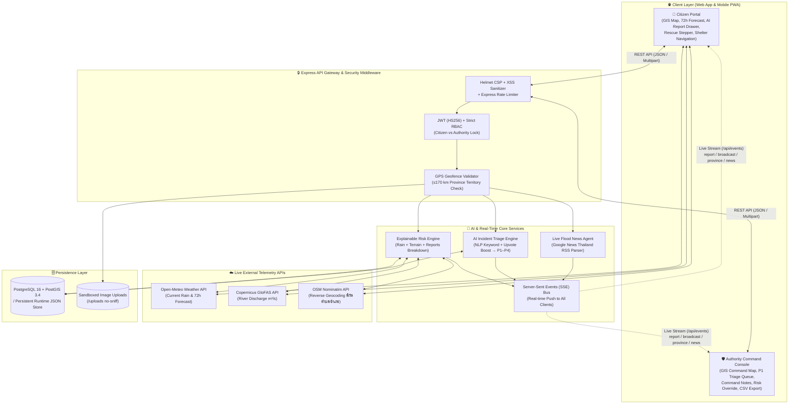
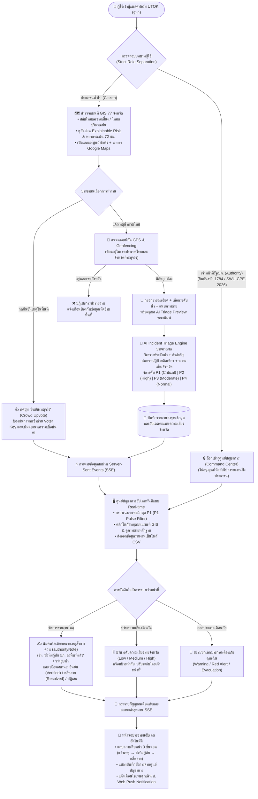
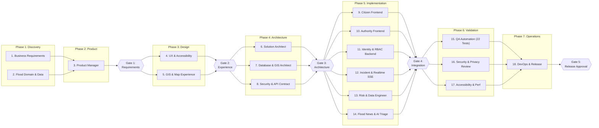

# UTOK (อุทก) — Thailand Flood Early Warning, Risk Assessment & Incident Reporting Platform

[](docs/AGENTIC_SDLC.md)
[](backend/test)
[](docs/SECURITY_GUIDE.md)
[](docs/USER_MANUAL.md)

แพลตฟอร์มดิจิทัลเตือนภัยน้ำท่วมล่วงหน้า (Flood Early Warning System: FEWS), ประเมินความเสี่ยงเชิงพื้นที่ 77 จังหวัด, รายงานเหตุฉุกเฉินพร้อมระบบคัดกรองความเร่งด่วนด้วย AI (**AI Incident Triage P1–P4**) และศูนย์บัญชาการกู้ภัยแบบ Real-time เชื่อมโยงข้อมูลอุตุนิยมวิทยาและปริมาณน้ำท่าสดระดับโลก พัฒนาขึ้นด้วยกระบวนการ **Agentic Engineering** ผ่านทีมวิศวกรซอฟต์แวร์ปัญญาประดิษฐ์ (**18 Specialized AI Agents**) ตามวงจรการพัฒนาระบบ (SDLC)

> **โครงงานรายวิชา**: การพัฒนาซอฟต์แวร์ด้วยวิศวกรรมเอเจนต์ (Agentic Software Engineering)  
> **สังกัด**: ภาควิชาวิศวกรรมคอมพิวเตอร์ คณะวิศวกรรมศาสตร์ มหาวิทยาลัยศรีนครินทรวิโรฒ (มศว)  
> **อาจารย์ที่ปรึกษา**: ผศ.วัชรชัย วิริยะสุทธิวงศ์

---

## 📑 สารบัญเอกสารและคู่มือในคลังโค้ด (Documentation Index)

- 📘 [**คู่มือการใช้งานระบบสำหรับผู้ใช้ (`docs/USER_MANUAL.md`)**](docs/USER_MANUAL.md) — วิธีใช้งานสำหรับประชาชน (`Citizen`) และเจ้าหน้าที่ (`Authority`), การปักหมุดแจ้งเหตุ, การดู GPS สด และการติดตั้งแอปมือถือ PWA
- 🛡️ [**คู่มือสถาปัตยกรรมความปลอดภัย (`docs/SECURITY_GUIDE.md`)**](docs/SECURITY_GUIDE.md) — รายละเอียดการป้องกัน OWASP Top 10, Strict Role Separation, GPS Geofencing, Anti-XSS, File Upload Sandboxing และ Rate Limiting
- 🤖 [**คู่มือทีม 18 AI Agents และกระบวนการ SDLC (`docs/AGENTIC_SDLC.md`)**](docs/AGENTIC_SDLC.md) — โครงสร้างทีมวิศวกร AI 18 บทบาท, Dependency Graph, Handoffs และ 5 Human-in-the-Loop Checkpoints
- 🎬 [**คู่มือการนำเสนอและสคริปต์คลิป 7 ลำดับ (`agents/artifacts/presentation-guide.md`)**](agents/artifacts/presentation-guide.md) — ลำดับการนำเสนอและบทพูดสำหรับการสาธิตระบบ

---

## 1. ชื่อโครงการและสัญลักษณ์ระบบ (Project Name & Logo)

- **ชื่อระบบ**: **UTOK (อุทก) — Thailand Flood Risk Assessment & Incident Reporting Platform**
- **แนวคิดสัญลักษณ์ระบบ (Logo)**: ตราสัญลักษณ์หยดน้ำเรดาร์ UTOK Hydro-AI ([`docs/images/utok-logo.png`](docs/images/utok-logo.png) และ [`frontend/public/icon-512.svg`](frontend/public/icon-512.svg)) คู่กับตราสัญลักษณ์ทางการของ **คณะวิศวกรรมศาสตร์ มหาวิทยาลัยศรีนครินทรวิโรฒ** ([`docs/images/swu-eng-logo.jpg`](docs/images/swu-eng-logo.jpg) — รูปฟันเฟืองวิศวกรรมสีแดงเลือดหมูและกราฟโค้งการเจริญงอกงาม $y=e^x$) สื่อถึงนวัตกรรมวิศวกรรมคอมพิวเตอร์เพื่อการเฝ้าระวังอุทกภัยและคุ้มครองความปลอดภัยของประชาชนแบบ Real-time

---

## 2. ปัญหาและเหตุผลความจำเป็นของระบบ AI (Pain Points & Why AI)

### ปัญหาที่พบในระบบจัดการน้ำท่วมแบบเดิม (Pain Points)
1. **ข้อมูลกระจัดกระจายและขาดการพยากรณ์ล่วงหน้า**: ประชาชนไม่ทราบระดับความเสี่ยงของพื้นที่พักอาศัยหรือแนวโน้มฝนล่วงหน้า 72 ชั่วโมง จนกระทั่งมวลน้ำไหลเข้าท่วมพื้นที่
2. **รายงานเหตุการณ์ล้นทะลักและขาดการติดตามสถานะ (Report Overload & Blind Tracking)**: ในช่วงวิกฤตมีผู้แจ้งเหตุจำนวนมากผ่านโซเชียลมีเดียโดยขาดพิกัด GPS ที่แม่นยำ และผู้ประสบภัยไม่ทราบว่าเจ้าหน้าที่รับเรื่องหรือส่งทีมกู้ภัยออกมาแล้วหรือยัง
3. **การคัดกรองเคสฉุกเฉินล่าช้า (Delayed Triage)**: การคัดกรองด้วยมนุษย์ทำได้ช้าเมื่อมีข้อมูลจำนวนมาก ส่งผลให้กลุ่มเปราะบาง (ผู้ป่วยติดเตียง, ผู้สูงอายุ, เด็กเล็ก) หรือจุดที่มีอันตรายจากกระแสไฟฟ้ารั่วได้รับความช่วยเหลือล่าช้า
4. **ข้อมูลเท็จและการแจ้งเหตุข้ามพื้นที่**: ขาดกลไกตรวจสอบพิกัดจริงของผู้แจ้งและการยืนยันร่วมจากคนในชุมชน (Crowd Corroboration)

### ทำไมต้องพัฒนาระบบ AI มาช่วยแก้ปัญหานี้? (Why AI?)
- **Explainable AI Flood Risk Scoring (`0–100%`)**: ประมวลผลข้อมูลปริมาณฝนและโอกาสเกิดฝนสดจาก Open-Meteo, อัตราน้ำไหลจาก GloFAS, ความลุ่มต่ำของภูมิประเทศ และจำนวนรายงานเหตุจริงในพื้นที่ พร้อมแสดง **แถบสัดส่วนปัจจัยความเสี่ยง (Explainable Risk Breakdown Bar)** แยกตามปัจจัยอย่างโปร่งใสครบ 77 จังหวัด
- **Real-time AI Incident Triage (`P1 Critical → P4 Normal`)**: สแกนข้อความแจ้งเหตุ ระดับน้ำ พิกัดความเสี่ยง และจำนวนการกดยืนยันจากชุมชน (`Upvotes`) เพื่อตรวจจับคำสำคัญอันตรายถึงชีวิต (*"ไฟรั่ว"*, *"น้ำเชี่ยว"*, *"มิดหลังคา"*) และกลุ่มเปราะบาง (*"ผู้ป่วยติดเตียง"*, *"ผู้สูงอายุ"*, *"เด็กทารก"*) พร้อมจัดลำดับความสำคัญและสร้างข้อเสนอแนะกู้ภัยทันที
- **Live Flood News & Situational Intelligence Agent**: ดึงและสังเคราะห์ข่าวสารน้ำท่วมประเทศไทยจาก Google News RSS แบบสด สกัดชื่อจังหวัดที่ได้รับผลกระทบและสรุปใจความสำคัญอัตโนมัติ

---

## 3. แผนผังการทำงานของระบบ (System & Operational Flowcharts)

### 3.1 แผนผังสถาปัตยกรรมระบบและการไหลของข้อมูล (System Architecture Flowchart)



---

### 3.2 แผนผังกระบวนการทำงานของระบบตั้งแต่ต้นจนจบ (End-to-End Operational Flowchart)



---

### 3.3 แผนผังกระบวนการพัฒนาซอฟต์แวร์ด้วยทีม 18 AI Agents (Agentic SDLC Workflow)



---

## 4. สรุปฟีเจอร์และขีดความสามารถหลักของระบบ (Key Features)

ระบบรองรับผู้ใช้งาน **2 กลุ่มหลัก** โดยแยกบทบาทและสิทธิ์การเข้าถึงอย่างเคร่งครัด (**Strict Role Separation**):

### 👤 ฝั่งประชาชน (Citizen Experience)
- 📍 **ตรวจจับพิกัด GPS สดและที่อยู่จริงอัตโนมัติ**: แสดงพิกัดปัจจุบันพร้อมชื่อตำบล อำเภอ และจังหวัดจริงผ่าน Nominatim Reverse Geocoding
- 📊 **Explainable Risk Breakdown & พยากรณ์ฝนล่วงหน้า 72 ชั่วโมง**: แสดงแถบสัดส่วนคะแนนความเสี่ยงแยกตามปัจจัย (ฝน + พื้นที่ลุ่มต่ำ + รายงานเหตุจริง) พร้อมกราฟแนวโน้มปริมาณฝนและโอกาสเกิดฝนล่วงหน้า 3 วัน (72 ชั่วโมง)
- 🗺️ **แผนที่ GIS หลายเลเยอร์ (Multi-Layer Interactive GIS Map)**:
  - สลับมุมมองระหว่าง **โหมดความเสี่ยง (`Risk Mode`)** และ **โหมดปริมาณฝน (`Rainfall Mode`)** ระดับจังหวัด
  - เปิด/ปิดเลเยอร์ **ศูนย์พักพิงและจุดอพยพปลอดภัย (`Shelters Layer`)** พร้อมคำนวณระยะทางจริงจากพิกัดผู้ใช้ และปุ่มกด **นำทางด้วย Google Maps**
  - ปุ่มกรอง **เฉพาะเคสวิกฤต P1 (`P1 Critical Filter`)** พร้อมเอฟเฟกต์หมุดกระพริบเตือนภัย (`p1-pulse`)
- 📝 **แจ้งเหตุน้ำท่วมพร้อมระบบป้องกันข้อมูลเท็จ (Geofenced Reporting & AI Preview)**: อัปโหลดภาพถ่ายหน้างาน (สูงสุด 5 MB), ประเมินระดับความเร่งด่วนด้วย AI ขณะพิมพ์ และตรวจสอบพิกัด Geofencing ให้อยู่ในจังหวัดที่รายงานจริง
- 👍 **ระบบยืนยันเหตุการณ์โดยชุมชน (Crowd Upvote Corroboration)**: ประชาชนในพื้นที่สามารถกดปุ่ม **"ยืนยันเหตุจริง"** เพื่อช่วยเพิ่มน้ำหนักความน่าเชื่อถือให้ระบบ AI Triage
- 🛤️ **ติดตามสถานะการช่วยเหลือแบบ 3 ขั้นตอน (Rescue Progress Stepper)**: แสดงสถานะความคืบหน้า (`แจ้งเหตุแล้ว` → `รับเรื่อง/ส่งทีมกู้ภัย` → `คลี่คลายแล้ว`) พร้อมแสดง **บันทึกสั่งการจากศูนย์บัญชาการ (`authorityNote`)** แบบ Real-time
- ☎️ **คู่มือเตรียมความพร้อม ปภ. และสายด่วนฉุกเฉิน**: เช็กลิสต์การปฏิบัติตัวตามระดับความเสี่ยง และปุ่มโทรด่วน (`1784 ปภ.`, `1669 แพทย์ฉุกเฉิน`, `1196 อุบัติเหตุทางน้ำ`, `191`, `1129 การไฟฟ้า`)

### 🛡️ ฝั่งเจ้าหน้าที่ศูนย์บัญชาการ (Authority Operations Console)
- 🔒 **การล็อกสิทธิ์ศูนย์บัญชาการ (Dedicated Command Center Lock)**: ลงทะเบียนด้วยรหัสยืนยันหน่วยงานราชการ (`1784` หรือ `SWU-CPE-2026`) โดยบัญชีเจ้าหน้าที่จะถูกล็อกให้อยู่ในโหมดศูนย์บัญชาการเท่านั้น และไม่อนุญาตให้ส่งรายงานในฐานะประชาชนเพื่อความโปร่งใสของข้อมูล
- 🖥️ **แผนที่บัญชาการ GIS & คิวคัดกรองอัจฉริยะ (GIS Command Map & AI Triage Queue)**: คลิกที่รายการแจ้งเหตุเพื่อบินโฟกัสไปยังหมุดเกิดเหตุบนแผนที่ทันที กรองดูเฉพาะเคสวิกฤต P1 และเปิดดูภาพถ่ายหลักฐานขนาดใหญ่ (Photo Lightbox)
- ✍️ **ระบบบันทึกหมายเหตุการสั่งการ (`authorityNote` & Quick Presets)**: พิมพ์ข้อความแจ้งความคืบหน้าถึงผู้ประสบภัย หรือกดปุ่มข้อความด่วน (*"+ ส่งทีมกู้ภัย ปภ. ลงพื้นที่แล้ว"*, *"+ ประสานงานเทศบาลเร่งสูบน้ำ"*, *"+ ตรวจสอบและช่วยเหลือเรียบร้อย"*) ก่อนกดยืนยัน (`Verify`), คลี่คลาย (`Resolve`), หรือปฏิเสธ (`Reject`)
- 📥 **ส่งออกข้อมูลรายงานเป็นไฟล์ CSV (CSV Incident Export)**: ดาวน์โหลดตารางรายงานเหตุอุทกภัยพร้อมคะแนน AI Triage และหมายเหตุเจ้าหน้าที่เป็นไฟล์ `.csv` รองรับภาษาไทย (UTF-8 BOM)
- 🎚️ **ปรับความเสี่ยงรายจังหวัด (Manual Risk Override)**: ปรับระดับความเสี่ยงรายจังหวัดด้วยดุลยพินิจของเจ้าหน้าที่ พร้อมล็อกไม่ให้ระบบซิงค์อัตโนมัติเขียนทับ
- 📢 **การจัดการวงจรประกาศเตือนภัยฉุกเฉิน (Emergency Broadcast Lifecycle)**: ออกประกาศเตือนภัย (`Warning`, `Red Alert`, `Evacuation`) พร้อมเสียงไซเรนฉุกเฉินถึงประชาชนทุกเครื่องผ่าน SSE และสามารถกดยกเลิก/ลบประกาศเมื่อสถานการณ์คลี่คลายได้

---

## 5. รายละเอียดทีมวิศวกรซอฟต์แวร์ 18 AI Agents (Agentic SDLC)

กระบวนการพัฒนาซอฟต์แวร์ทั้งระบบขับเคลื่อนด้วยทีม **Multi-AI Agent 18 บทบาท** ภายใต้ 7 ระยะของ SDLC พร้อมการตรวจสอบย้อนกลับด้วยรหัส **SHA-256 Hash** ใน [`agents/logs/workflow-state.json`](agents/logs/workflow-state.json):

| ระยะ SDLC | AI Agents ในทีม | หน้าที่และความรับผิดชอบหลัก |
| :--- | :--- | :--- |
| **1. Discovery** | 1. `Business Requirements Agent`<br>2. `Flood Domain & Data Agent` | วิเคราะห์ Pain Points, กำหนดกลุ่มผู้ใช้ 2 บทบาท และรวบรวมเกณฑ์อุทกวิทยา 77 จังหวัด |
| **2. Product** | 3. `Product Manager Agent` | กำหนด PRD, User Stories, Acceptance Criteria และคู่มือการนำเสนอ |
| **3. Design** | 4. `UX & Accessibility Agent`<br>5. `GIS & Map Experience Agent` | ออกแบบ UI/UX ตามมาตรฐาน WCAG 2.1 AA, แถบพับซ้าย-ขวา และเลเยอร์แผนที่ GIS |
| **4. Architecture** | 6. `Solution Architect Agent`<br>7. `Database & GIS Architect Agent`<br>8. `Security & API Contract Agent` | ออกแบบสถาปัตยกรรม Full-stack Monorepo, สกีมา PostGIS, สัญญา OpenAPI และ Threat Model |
| **5. Implementation** | 9. `Citizen Portal Frontend Agent`<br>10. `Authority Dashboard Frontend Agent`<br>11. `Identity & Access Backend Agent`<br>12. `Incident, Broadcast & Realtime Agent`<br>13. `Flood Risk & Data Engineering Agent`<br>14. `Flood News & Situational Intelligence Agent` | พัฒนาโค้ด Frontend (React 18 / Leaflet / PWA), Backend (Express / SSE / Geofencing), โมเดล Explainable Risk, AI Triage P1–P4 และระบบดึงสภาพอากาศ/ข่าวน้ำท่วมสด |
| **6. Validation** | 15. `QA Automation Agent`<br>16. `Security & Privacy Review Agent`<br>17. `Accessibility & Performance Agent` | ตรวจสอบคุณภาพด้วยชุดทดสอบอัตโนมัติ **22/22 Tests**, ตรวจสอบความปลอดภัย OWASP Top 10 และวัดประสิทธิภาพ API/Map |
| **7. Operations** | 18. `DevOps & Release Agent` | จัดทำ Docker Compose, คู่มือการติดตั้ง, ตรวจสอบ Release Gate และเตรียมแพ็กเกจส่งมอบงาน |

---

## 6. โครงสร้างโปรเจกต์และ REST API หลัก (Project Structure & API Endpoints)

```text
SW_Project/
├── frontend/                  # React 18 + Vite + Leaflet GIS + Mobile PWA
│   ├── public/                # PWA manifest, Service Worker (sw.js), ไอคอนระบบ
│   └── src/
│       ├── components/        # CitizenView, AuthorityView, FloodMap, ReportDrawer, LoginModal ฯลฯ
│       ├── services/          # API client, Client AI Triage, Live Weather/GeoJSON, Web Audio Siren
│       ├── App.jsx            # State orchestration & Real-time SSE event listeners
│       └── styles.css         # Responsive GIS command center & mobile PWA styling
├── backend/                   # Node.js + Express REST API & Real-time SSE Server
│   ├── data/                  # Persistent JSON runtime store (runtime-store.json)
│   ├── src/
│   │   ├── config/            # PostgreSQL / PostGIS connection pool
│   │   ├── data/              # 77-province catalog, repository & seed data
│   │   ├── middleware/        # JWT (HS256) authentication & strict RBAC guards
│   │   ├── routes/            # auth, reports, provinces, broadcasts, events, intelligence
│   │   ├── services/          # riskService, aiTriageService, newsAgentService, weatherService, eventBus
│   │   └── utils/             # Anti-XSS text & filename sanitization
│   └── test/                  # Automated unit & integration test suite (22 tests)
├── database/                  # PostgreSQL + PostGIS spatial schema.sql & seed.sql
├── dataset/                   # ชุดข้อมูลความเสี่ยงน้ำท่วม 77 จังหวัด (.csv และ .json)
├── agents/                    # 18 AI Agents prompts, artifacts, runner & SHA-256 audit logs
├── docs/                      # คู่มือ USER_MANUAL.md, SECURITY_GUIDE.md, AGENTIC_SDLC.md
└── scripts/                   # Dev runner, performance check & presentation generator
```

### ตารางสรุป REST API หลัก

| Method | Endpoint | สิทธิ์การเข้าถึง | รายละเอียดการทำงาน |
| :--- | :--- | :--- | :--- |
| `GET` | `/api/health` | Public | ตรวจสอบสถานะเซิร์ฟเวอร์และการเชื่อมต่อฐานข้อมูล |
| `POST` | `/api/auth/register` | Public | ลงทะเบียนผู้ใช้งานจริง (`citizen` หรือ `authority` พร้อมรหัสหน่วยงาน `1784` / `SWU-CPE-2026`) |
| `POST` | `/api/auth/login` | Public | เข้าสู่ระบบและรับโทเคน JWT (`HS256`) |
| `GET` / `PATCH` | `/api/auth/me` / `/api/auth/profile` | Auth | อ่านหรืออัปเดตข้อมูลโปรไฟล์และพิกัดบ้านของผู้ใช้ |
| `GET` | `/api/auth/my-reports` | Citizen | ดึงประวัติรายงานแจ้งเหตุเฉพาะของตนเอง |
| `GET` | `/api/provinces` | Public | ดึงข้อมูลความเสี่ยงน้ำท่วม สภาพอากาศ และพยากรณ์ฝนครบ 77 จังหวัด |
| `POST` | `/api/provinces/sync-weather` | Public | ซิงค์ข้อมูลฝนและน้ำท่าสดจาก Open-Meteo & GloFAS |
| `PATCH` | `/api/provinces/:id/risk` | Authority | ปรับระดับความเสี่ยงรายจังหวัดด้วยดุลยพินิจของเจ้าหน้าที่ |
| `GET` / `POST` | `/api/reports` | Public / Citizen | อ่านรายการแจ้งเหตุ หรือส่งรายงานเหตุน้ำท่วมใหม่พร้อมรูปภาพ (ตรวจ Geofencing) |
| `POST` | `/api/reports/:id/upvote` | Public / Auth | กดยืนยันเหตุการณ์จริง (Crowd Upvote) และอัปเดตความเชื่อมั่น AI Triage |
| `PATCH` | `/api/reports/:id/status` | Authority | เปลี่ยนสถานะรายงาน (`pending`, `verified`, `resolved`, `rejected`) พร้อมแนบ `authorityNote` |
| `DELETE` | `/api/reports/:id` | Owner / Authority | ลบรายงานเหตุการณ์และคำนวณจำนวนเคสในจังหวัดใหม่ |
| `GET` / `POST` | `/api/broadcasts` | Public / Authority | อ่านหรือสร้างประกาศเตือนภัยฉุกเฉิน (`warning`, `red`, `evacuation`) |
| `DELETE` | `/api/broadcasts/:id` | Authority | ยกเลิก/ลบประกาศเตือนภัยเมื่อสถานการณ์คลี่คลาย |
| `POST` | `/api/ai/triage` | Public | วิเคราะห์ข้อความแจ้งเหตุและคำนวณระดับความเร่งด่วน AI Triage (`P1–P4`) |
| `GET` | `/api/weather/point` | Public | ดึงข้อมูลสภาพอากาศและอัตราการไหลของน้ำรายจุดพิกัด `lat, lng` |
| `GET` / `POST` | `/api/news` / `/api/news/refresh` | Public | ดึงหรือสั่งสแกนข่าวสารน้ำท่วมประเทศไทยสดจาก RSS พร้อมบทสรุป AI |
| `GET` | `/api/events` | Public | ท่อเชื่อมต่อ Real-time Server-Sent Events (SSE) |

---

## 7. แผนการพัฒนาต่อยอดในอนาคต (Future Work Development)

1. **AI วิเคราะห์ภาพถ่ายดาวเทียมและภาพหน้างานอัตโนมัติ (Computer Vision & SAR Satellite AI)**: ใช้โมเดล Computer Vision ประเมินระดับความลึกของน้ำจากภาพถ่ายที่ประชาชนแนบมาโดยอัตโนมัติ และวิเคราะห์ขอบเขตน้ำท่วมจากภาพถ่ายดาวเทียมเรดาร์ GISTDA
2. **แบบจำลองพยากรณ์น้ำหลากด้วย Deep Learning (Spatio-Temporal Flood Forecasting)**: พัฒนาโมเดล LSTM / Graph Neural Network ร่วมกับข้อมูลความลาดชันและปริมาณน้ำเขื่อนจาก สสน. (ThaiWater) เพื่อพยากรณ์ระดับน้ำล่วงหน้าแยกรายตำบล
3. **ระบบจัดสรรทรัพยากรกู้ภัยและนำทางหลบน้ำท่วม (Smart Rescue Dispatch & Evacuation Routing)**: คำนวณเส้นทางอพยพที่ปลอดภัยโดยหลีกเลี่ยงจุดที่มีหมุดรายงานน้ำท่วมสูงเกิน 50 ซม. และติดตามตำแหน่งเรือ/รถกู้ภัยแบบสด
4. **การเชื่อมต่อระบบเตือนภัยระดับชาติ (Cell Broadcast & Omnichannel Alerting)**: เชื่อมต่อประกาศเตือนภัยเข้ากับระบบ Cell Broadcast Service (CBS), SMS Gateway และ LINE Official Account เพื่อแจ้งเตือนประชาชนแม้ในพื้นที่ที่อินเทอร์เน็ตขัดข้อง

---

## 8. เอกสารอ้างอิง (References)

1. **กรมป้องกันและบรรเทาสาธารณภัย กระทรวงมหาดไทย (DDPM)**. (2567). *แผนการป้องกันและบรรเทาสาธารณภัยแห่งชาติ และแนวปฏิบัติศูนย์นิรภัย 1784*. สืบค้นจาก https://www.disaster.go.th
2. **สถาบันสารสนเทศทรัพยากรน้ำ (องค์การมหาชน) - สสน.** (2567). *คลังข้อมูลน้ำแห่งชาติ (ThaiWater)*. สืบค้นจาก https://www.thaiwater.net
3. **สำนักงานพัฒนาเทคโนโลยีอวกาศและภูมิสารสนเทศ (องค์การมหาชน) - GISTDA**. (2567). *ระบบติดตามสถานการณ์น้ำท่วมจากดาวเทียม (Thailand Flood Monitoring System)*. สืบค้นจาก https://flood.gistda.or.th
4. **Open-Meteo & Copernicus Emergency Management Service (GloFAS)**. (2024). *High-Resolution Weather Forecast and Global Flood Awareness System River Discharge API*. Retrieved from https://open-meteo.com/en/docs/flood-api
5. **Open Web Application Security Project (OWASP)**. (2024). *OWASP Top 10 Web Application Security Risks*. Retrieved from https://owasp.org/www-project-top-ten/
6. **PostGIS Project Steering Committee & OpenStreetMap Foundation**. (2024). *PostGIS Spatial Database Documentation & Leaflet Interactive Mapping*. Retrieved from https://postgis.net/documentation/

---

## 9. ข้อมูลคณะผู้จัดทำและสถาบัน (Credits)

- **สังกัด**: ภาควิชาวิศวกรรมคอมพิวเตอร์ คณะวิศวกรรมศาสตร์ มหาวิทยาลัยศรีนครินทรวิโรฒ (มศว)
- **อาจารย์ที่ปรึกษา**: ผศ.วัชรชัย วิริยะสุทธิวงศ์

---

## 🚀 วิธีการติดตั้งและรันระบบ (Quick Start)

### ข้อกำหนดระบบ (Prerequisites)
- **Node.js** เวอร์ชัน 20 ขึ้นไป และ **npm** เวอร์ชัน 10 ขึ้นไป

### 1. ติดตั้ง Dependencies และรันระบบ Full-Stack
```bash
# จากโฟลเดอร์ SW_Project
npm install

# รันระบบทั้ง Frontend (พอร์ต 5173) และ Backend API (พอร์ต 4000) พร้อมกัน
npm run dev
```
- **เข้าใช้งานเว็บไซต์ (Frontend Web & PWA)**: <http://localhost:5173>
- **ตรวจสอบสถานะระบบหลังบ้าน (Backend Health Check)**: <http://localhost:4000/api/health>

### 2. การลงทะเบียนและทดสอบระบบ 2 บทบาทผู้ใช้
- **ประชาชนทั่วไป (`Citizen`)**: กดปุ่ม **"เข้าสู่ระบบ / สมัคร"** มุมขวาบน → เลือกแท็บ **"ลงทะเบียนใช้งานจริง"** → เลือกบทบาท **"ประชาชนทั่วไป"** เพื่อสร้างบัญชีและแจ้งเหตุในพื้นที่พิกัด GPS ของตน
- **เจ้าหน้าที่รัฐ/ปภ. (`Authority`)**: เลือกแท็บ **"ลงทะเบียนใช้งานจริง"** → เลือกบทบาท **"เจ้าหน้าที่รัฐ / ปภ."** → กรอกรหัสยืนยันหน่วยงานราชการ **`1784`** หรือ **`SWU-CPE-2026`** เพื่อเข้าสู่ศูนย์บัญชาการ

### 3. คำสั่งทดสอบคุณภาพและตรวจสอบทีม AI Agents
```bash
# รันชุดทดสอบอัตโนมัติ Backend, Security & Geofencing ทั้งหมด (22/22 Tests)
npm test

# Build โปรดักชันบันเดิลสำหรับ Web และ PWA
npm run build

# ตรวจสอบสถานะการทำงานและ SHA-256 Audit Logs ของทีม 18 AI Agents
npm run agents:status
npm run agents:run
```
