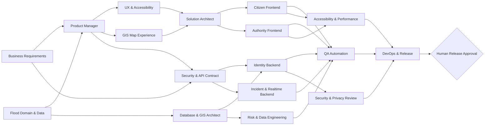

# Agent Operating Model and Handoff Matrix

The Human Orchestrator owns scope and approval. Agents may produce evidence only within their assigned workstream and cannot bypass a pending checkpoint.

## Team topology

| Phase | Specialized Agents | Primary handoff |
| --- | --- | --- |
| Discovery | Business Requirements; Flood Domain & Data | Requirement and domain baselines → Product |
| Product | Product Manager | PRD and stories → Design/Architecture |
| Design | UX & Accessibility; GIS & Map Experience | Interaction contracts → Architecture/Frontend |
| Architecture | Solution; Database & GIS; Security & API | Architecture/schema/API contracts → Implementation |
| Implementation | Citizen Frontend; Authority Frontend; Identity Backend; Incident/Realtime Backend; Risk/Data | Runnable integrated system → Validation |
| Validation | QA Automation; Security & Privacy; Accessibility & Performance | Independent evidence → DevOps/Release |
| Operations | DevOps & Release | Release package → Human Orchestrator |

## Dependency flow

## Human checkpoints

1. Requirements: validates product scope.
2. Experience: validates Citizen/Authority journeys and map behavior.
3. Architecture: validates boundaries, schema and security contract.
4. Integration: validates that implementation streams work together.
5. Release: validates all evidence and remains pending until the student approves it.
