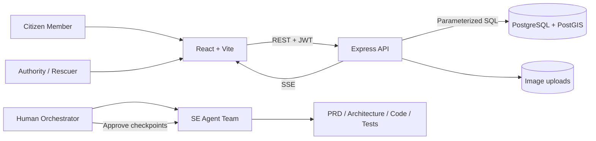
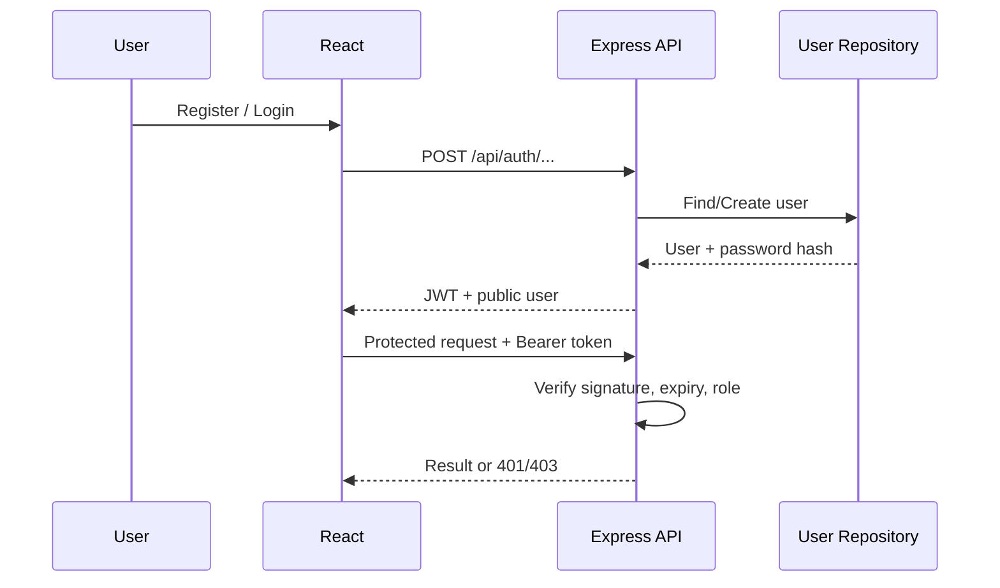
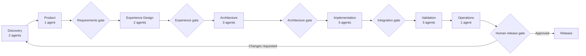

# Software Architecture

## System context

## Components

| Component | Responsibility |
| --- | --- |
| React frontend | Authentication UI, Citizen portal, Authority dashboard, Leaflet map |
| Express API | Validation, authentication, RBAC, reports, risk zones, broadcasts |
| Repository | Adapter ระหว่าง in-memory demo และ PostgreSQL |
| PostgreSQL/PostGIS | Users, roles, spatial risk zones, reports และ broadcasts |
| SSE event bus | แจ้ง client เมื่อ report/risk/broadcast เปลี่ยน |
| Agent orchestrator | รัน agent ตาม phase, ตรวจ artifacts และบังคับ human checkpoints |

## Performance architecture

- Province and report map layers are isolated; incident events do not redraw all 77 province overlays.
- Leaflet uses Canvas for province circles to reduce DOM/SVG overhead.
- SSE payloads update only the changed entity instead of triggering full API reloads.
- Province and broadcast reads use short public cache windows with stale revalidation.
- Express compresses JSON/static responses but explicitly excludes the SSE stream.
- Operational report queries enforce bounded result limits.

## Authentication and authorization

## Trust boundaries

- Browser input is untrusted and validated by API
- JWT secret exists only in backend environment
- Password hashes never leave repository/auth layer
- Database traffic uses parameterized SQL
- Upload middleware restricts MIME type and file size
- Static MVP data is for demonstration, not an official disaster warning

## Agentic SDLC

The 17-agent dependency graph, workstream ownership and handoff matrix are defined in `agent-operating-model.md`. Runtime validation rejects unknown agents, same-phase/backward dependencies, missing outputs, and invalid handoff recipients before execution begins.
