# การสร้าง Software Engineer Team ด้วย Multi AI Agents (Agentic SDLC)
**Multi-AI Agent Software Engineering Architecture for ThaiFlood Watch**
*ภาควิชาวิศวกรรมคอมพิวเตอร์ คณะวิศวกรรมศาสตร์ มหาวิทยาลัยศรีนครินทรวิโรฒ*
*ที่ปรึกษา: ผศ.วัชรชัย วิริยะสุทธิวงศ์*

---

## 🎯 ตอบโจทย์การนำเสนอ ลำดับที่ 4 ของโครงงาน

เอกสารฉบับนี้จัดทำขึ้นเพื่อใช้อ้างอิงและนำเสนอตามข้อกำหนดของรายวิชา หัวข้อ **"Building a SE Team of AI Agents to design & develop software"** โดยนำเสนอกระบวนการพัฒนาซอฟต์แวร์ตามวงจรการพัฒนาระบบ (Software Development Life Cycle - SDLC) ผ่านทีมวิศวกรซอฟต์แวร์ปัญญาประดิษฐ์ (Multi-AI Agent Team) จำนวน **18 บทบาทเฉพาะทาง** ครอบคลุมทั้ง 7 ระยะของการพัฒนา

---

## 4.1 Software Engineer Team : 18 AI Agents

ทีมงาน AI Agents ทั้ง 18 ตัว ถูกแบ่งหน้าที่ตามความเชี่ยวชาญเฉพาะด้าน (Separation of Concerns) ตามลำดับ SDLC:

```mermaid
graph TD
    subgraph P1["1. Discovery Phase"]
        A1["Business Requirements Agent"]
        A2["Flood Domain & Data Agent"]
    end

    subgraph P2["2. Product Planning"]
        A3["Product Manager Agent"]
    end

    subgraph P3["3. Design Phase"]
        A4["UX & Accessibility Agent"]
        A5["GIS & Map Experience Agent"]
    end

    subgraph P4["4. Architecture Phase"]
        A6["Solution Architect Agent"]
        A7["Database & GIS Architect Agent"]
        A8["Security & API Contract Agent"]
    end

    subgraph P5["5. Implementation Phase"]
        A9["Citizen Portal Frontend Agent"]
        A10["Authority Dashboard Frontend Agent"]
        A11["Identity & Access Backend Agent"]
        A12["Incident, Broadcast & Realtime Agent"]
        A13["Flood Risk & Data Engineering Agent"]
        A14["Flood News & Situational Intelligence Agent"]
    end

    subgraph P6["6. Validation Phase"]
        A15["QA Automation Agent"]
        A16["Security & Privacy Review Agent"]
        A17["Accessibility & Performance Agent"]
    end

    subgraph P7["7. Operations & Release"]
        A18["DevOps & Release Agent"]
    end

    P1 -->|Handoff| P2
    P2 -->|Handoff + CP1| P3
    P3 -->|Handoff + CP2| P4
    P4 -->|Handoff + CP3| P5
    P5 -->|Handoff + CP4| P6
    P6 -->|Handoff| P7
    P7 -->|CP5 Release| Done["Production Release"]
```

### รายละเอียดหน้าที่ของทั้ง 18 AI Agents

| ระยะ SDLC | รหัส | ชื่อ AI Agent | หน้าที่และความรับผิดชอบหลัก | Artifacts ที่ส่งมอบ |
| :--- | :--- | :--- | :--- | :--- |
| **1. Discovery** | `A1` | **Business Requirements Agent** | วิเคราะห์ปัญหาและรวบรวมความต้องการของประชาชนและหน่วยงานภาครัฐ | [stakeholder-requirements.md](file:///Users/thuwanon/Documents/cpe_sw/SW_Project/agents/artifacts/stakeholder-requirements.md) |
| | `A2` | **Flood Domain & Data Agent** | กำหนดปัจจัยทางอุทกวิทยา (ฝน, ลำน้ำ, ความสูง) และแหล่งข้อมูลจริง | [flood-domain-data.md](file:///Users/thuwanon/Documents/cpe_sw/SW_Project/agents/artifacts/flood-domain-data.md) |
| **2. Product** | `A3` | **Product Manager Agent** | วาง Product Roadmap, จัดลำดับความสำคัญของฟีเจอร์ และเขียน PRD | [PRD.md](file:///Users/thuwanon/Documents/cpe_sw/SW_Project/agents/artifacts/PRD.md), [user-stories.md](file:///Users/thuwanon/Documents/cpe_sw/SW_Project/agents/artifacts/user-stories.md) |
| **3. Design** | `A4` | **UX & Accessibility Agent** | ออกแบบโครงสร้างหน้าจอตามมาตรฐาน WCAG 2.1 AA รองรับผู้ใช้งานทุกกลุ่ม | [ux-accessibility-spec.md](file:///Users/thuwanon/Documents/cpe_sw/SW_Project/agents/artifacts/ux-accessibility-spec.md) |
| | `A5` | **GIS & Map Experience Agent** | ออกแบบระบบแสดงผลแผนที่เชิงพื้นที่ มาร์กเกอร์สีเตือนภัย และ GPS ปัจจุบัน | [gis-visual-spec.md](file:///Users/thuwanon/Documents/cpe_sw/SW_Project/agents/artifacts/gis-visual-spec.md) |
| **4. Architecture** | `A6` | **Solution Architect Agent** | ออกแบบภาพรวมระบบ (Monorepo, REST API, Server-Sent Events, PWA) | [architecture.md](file:///Users/thuwanon/Documents/cpe_sw/SW_Project/agents/artifacts/architecture.md) |
| | `A7` | **Database & GIS Architect Agent** | ออกแบบ Schema PostgreSQL, PostGIS Geometry และ In-memory Store | [data-gis-design.md](file:///Users/thuwanon/Documents/cpe_sw/SW_Project/agents/artifacts/data-gis-design.md), [schema.sql](file:///Users/thuwanon/Documents/cpe_sw/SW_Project/database/schema.sql) |
| | `A8` | **Security & API Contract Agent** | กำหนดสัญญา API (OpenAPI 3.1) และนโยบายความปลอดภัย RBAC/JWT | [api-spec.yaml](file:///Users/thuwanon/Documents/cpe_sw/SW_Project/agents/artifacts/api-spec.yaml), [threat-model.md](file:///Users/thuwanon/Documents/cpe_sw/SW_Project/agents/artifacts/threat-model.md) |
| **5. Implementation** | `A9` | **Citizen Portal Frontend Agent** | พัฒนาหน้าเว็บฝั่งประชาชน แผนที่โต้ตอบ และระบบส่งรายงานแจ้งเหตุ | `CitizenView.jsx`, `FloodMap.jsx`, `ReportDrawer.jsx` |
| | `A10` | **Authority Dashboard Frontend Agent** | พัฒนาคอนโซลควบคุมสถานการณ์ของเจ้าหน้าที่และการออกประกาศฉุกเฉิน | `AuthorityView.jsx`, `BroadcastModal.jsx` |
| | `A11` | **Identity & Access Backend Agent** | พัฒนาระบบยืนยันตัวตน JWT, bcrypt, การลงทะเบียน 2 บทบาท | `routes/auth.js`, `middleware/auth.js` |
| | `A12` | **Incident, Broadcast & Realtime Agent** | พัฒนา Operational API, SSE Event Bus, และระบบแจ้งเตือนฉุกเฉิน | `routes/reports.js`, `routes/broadcasts.js`, `eventBus.js` |
| | `A13` | **Flood Risk & Data Engineering Agent** | พัฒนาระบบเชื่อมต่อ Open-Meteo, GloFAS River API, 77 จังหวัด | `weatherService.js`, `riskService.js`, `provinceCatalog.js` |
| | `A14` | **Flood News & Situational Intelligence Agent** | พัฒนาระบบ AI Incident Triage (P1–P4) และ Agent ติดตามข่าวสารน้ำท่วมสด | `aiTriageService.js`, `newsAgentService.js`, `aiTriage.js` |
| **6. Validation** | `A15` | **QA Automation Agent** | เขียนชุดทดสอบอัตโนมัติ Unit Test, Integration Test และ Data Assertion | `test/*.test.js`, [test-report.md](file:///Users/thuwanon/Documents/cpe_sw/SW_Project/agents/artifacts/test-report.md) |
| | `A16` | **Security & Privacy Review Agent** | ตรวจสอบช่องโหว่ OWASP, Anti-XSS, File Upload, และ Rate Limiting | [security-review.md](file:///Users/thuwanon/Documents/cpe_sw/SW_Project/agents/artifacts/security-review.md), `security.test.js` |
| | `A17` | **Accessibility & Performance Agent** | ตรวจสอบ Contrast Ratio, คีย์บอร์ดนำทาง, Lighthouse Score | [accessibility-performance-report.md](file:///Users/thuwanon/Documents/cpe_sw/SW_Project/agents/artifacts/accessibility-performance-report.md) |
| **7. Operations** | `A18` | **DevOps & Release Agent** | จัดทำ Docker Compose, PWA Manifest, Service Worker, และคู่มือส่งมอบ | `docker-compose.yml`, `sw.js`, [deployment-runbook.md](file:///Users/thuwanon/Documents/cpe_sw/SW_Project/agents/artifacts/deployment-runbook.md) |

---

## 4.2 AI Agents Workflow & Human Checkpoints

การทำงานร่วมกันระหว่าง Agents ดำเนินการผ่านระบบ **Workflow Orchestration Engine** (`agents/run.mjs`) โดยมีการส่งต่องาน (Artifact Handoff) และตรวจสอบความสมบูรณ์ด้วยการคำนวณ **SHA-256 Checksum** ทุกขั้นตอน

นอกจากนี้ เพื่อให้เป็นไปตามหลักการ **Responsible AI** ระบบได้กำหนดจุดตรวจสอบโดยมนุษย์ (**5 Human Checkpoints**) ซึ่งต้องได้รับการอนุมัติ (Approval) ก่อนจึงจะดำเนินงานเฟสถัดไปได้:

1. **Checkpoint 1 — Requirements Approval**: อนุมัติขอบเขตระบบและ Pain Point
2. **Checkpoint 2 — Experience & UI Approval**: อนุมัติการออกแบบ UX/UI แผนที่ และการรองรับการเข้าถึง (A11y)
3. **Checkpoint 3 — Architecture Approval**: อนุมัติสถาปัตยกรรม Monorepo, สกีมาฐานข้อมูล, และสัญญา API
4. **Checkpoint 4 — Integration Approval**: อนุมัติการเชื่อมต่อ Frontend, Backend, AI Triage, และ Real-time Events
5. **Checkpoint 5 — Release Approval**: ตรวจสอบผลการทดสอบครบ 100% และอนุมัติปล่อยซอฟต์แวร์สู่ Production

---

## 4.3 Design & Dev Tools

เครื่องมือและเทคโนโลยีที่ใช้ในการออกแบบและพัฒนาระบบ:

* **Agentic Framework**: Node.js ESM Orchestration Engine พร้อม State Machine และ Audit Logging (`agent-execution.jsonl`)
* **Design & Prototyping**: Responsive Design Tokens, Figma UX Specs, WCAG 2.1 AA Checklist, SVG Icons (Lucide)
* **Frontend Stack**: React 18, Vite, Leaflet.js (Interactive Maps), Progressive Web App (PWA Service Worker)
* **Backend Stack**: Node.js 20, Express, Multer (Safe File Uploads), Server-Sent Events (SSE), Helmet, Rate Limiters
* **Geospatial & Data Stack**: PostgreSQL + PostGIS, Open-Meteo Weather API, GloFAS River Discharge API, OpenStreetMap Nominatim
* **Quality Assurance & Testing**: Node.js Native Test Runner (`node --test`), Performance Benchmark Scripts, Docker Compose
