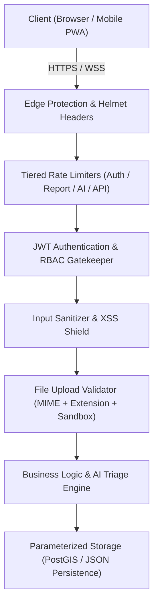

# คู่มือความปลอดภัยและการป้องกันระบบ (Security Guide & Threat Model)
**ThaiFlood Watch — Security Architecture and OWASP Compliance**
*ภาควิชาวิศวกรรมคอมพิวเตอร์ คณะวิศวกรรมศาสตร์ มหาวิทยาลัยศรีนครินทรวิโรฒ*

---

## 🛡️ ภาพรวมความปลอดภัย (Security Overview)

ระบบ **ThaiFlood Watch** ได้รับการออกแบบตามแนวคิด **Defense-in-Depth** และปฏิบัติตามมาตรฐานความปลอดภัยของเว็บแอปพลิเคชันสากล (OWASP Top 10) เพื่อให้มั่นใจว่าข้อมูลแจ้งเหตุของประชาชนและระบบสั่งการของเจ้าหน้าที่มีความน่าเชื่อถือ ปลอดภัยจากการโจมตี และพร้อมใช้งานในภาวะฉุกเฉินตลอดเวลา



---

## 1. การควบคุมการเข้าถึงและการยืนยันตัวตน (Authentication & RBAC)

### 1.1 การจัดเก็บรหัสผ่าน (Password Hashing)
- รหัสผ่านของผู้ใช้งานทุกคนผ่านการเข้ารหัสด้วย **`bcrypt` ด้วย Cost Factor 12 Rounds** พร้อมการทำ Salt อัตโนมัติ (`gen_salt('bf')`)
- ระบบไม่มีการจัดเก็บ Plain-text Password ในหน่วยความจำหรือฐานข้อมูล
- บังคับความยาวรหัสผ่านขั้นต่ำอย่างน้อย **8 ตัวอักษร**

### 1.2 การจัดการ Session ด้วย JSON Web Token (JWT)
- ออก Token ที่ลงนามด้วยอัลกอริทึม **HMAC-SHA256** พร้อมระบุ `issuer: 'thaiflood-api'`
- กำหนดอายุ Token สั้นเพียง **8 ชั่วโมง** เพื่อจำกัดกรอบความเสียหายกรณี Token ถูกขโมย
- เมื่อส่งคืนข้อมูลโปรไฟล์ผู้ใช้ (`/api/auth/me`, `/api/auth/profile`) ฟิลด์ `password_hash` จะถูกลบออก (`delete user.password_hash`) เสมอเพื่อป้องกันข้อมูลรั่วไหล

### 1.3 การแบ่งระดับสิทธิ์ (Role-Based Access Control - RBAC)
- แบ่งกลุ่มผู้ใช้งานเป็น **`citizen`** และ **`authority`** อย่างเข้มงวดผ่าน Middleware:
  - `requireAuth`: ตรวจสอบความถูกต้องและวันหมดอายุของ JWT
  - `requireAuthority`: ตรวจสอบว่าผู้ใช้มีบทบาทเป็น `authority` เท่านั้น (ปฏิเสธ Citizen ด้วย HTTP 403 Forbidden)
  - `requireCitizen`: อนุญาตเฉพาะประชาชนในการเรียกดูประวัติรายงานส่วนบุคคล
- **Authority Verification Code**: การสมัครบัญชีเจ้าหน้าที่ต้องผ่านการตรวจสอบรหัสหน่วยงานที่ได้รับอนุญาต (`1784`, `SWU-CPE-2026`) ป้องกันบุคคลทั่วไปแอบอ้างสิทธิ์ฝ่ายปกครอง

---

## 2. การป้องกัน Cross-Site Scripting (Anti-XSS & Input Sanitization)

### 2.1 Stored XSS Mitigation
ทุกช่องทางที่รับข้อมูลจากผู้ใช้ (User Inputs) ใน [sanitize.js](file:///Users/thuwanon/Documents/cpe_sw/SW_Project/backend/src/utils/sanitize.js) จะถูกฟอกทำความสะอาดก่อนบันทึกและส่งต่อ:
```javascript
export function sanitizeText(input, maxLength = 2000) {
  if (input == null) return "";
  return String(input)
    .replace(/[\u0000-\u0008\u000B\u000C\u000E-\u001F\u007F]/g, "") // ตัด Control Characters ที่มองไม่เห็น
    .replace(/&/g, "&amp;")
    .replace(/</g, "&lt;")
    .replace(/>/g, "&gt;")
    .replace(/"/g, "&quot;")
    .replace(/'/g, "&#39;")
    .trim()
    .slice(0, maxLength);
}
```
ครอบคลุมข้อมูล:
- ข้อความแจ้งเหตุ (`description`)
- ชื่ออำเภอ/สถานที่ (`district`)
- หัวข้อประกาศเตือนภัยและคำแนะนำ (`headline`, `advisory`)
- ชื่อผู้แจ้ง, เบอร์โทรศัพท์, และสังกัดหน่วยงาน

### 2.2 Security HTTP Headers (Helmet)
ใน [app.js](file:///Users/thuwanon/Documents/cpe_sw/SW_Project/backend/src/app.js) มีการติดตั้ง HTTP Security Headers ครบถ้วน:
- `X-Content-Type-Options: nosniff` (ป้องกัน MIME Sniffing)
- `X-XSS-Protection: 1; mode=block`
- `X-Frame-Options: SAMEORIGIN` (ป้องกัน Clickjacking)
- `Content-Security-Policy`: กำหนดสิทธิ์การโหลดสคริปต์และคอนเทนต์อย่างรัดกุม

---

## 3. ความปลอดภัยในการอัปโหลดไฟล์ภาพหลักฐาน (File Upload Hardening)

การอัปโหลดรูปภาพหลักฐานน้ำท่วม ([reports.js](file:///Users/thuwanon/Documents/cpe_sw/SW_Project/backend/src/routes/reports.js)) มีกลไกป้องกัน 5 ชั้น:

1. **จำกัดขนาดไฟล์ (File Size Limit)**: กำหนดเพดานสูงสุดที่ **5 MB** ป้องกันการโจมตีแบบ Resource Exhaustion / Disk Flooding
2. **การตรวจสอบ MIME Type**: อนุญาตเฉพาะไฟล์ที่ขึ้นต้นด้วย `image/` เท่านั้น
3. **บล็อกไฟล์ SVG (Anti-SVG XSS)**: ไม่อนุญาตไฟล์ `image/svg+xml` เนื่องจากไฟล์ SVG สามารถฝัง JavaScript แท็ก `<script>` หรือ Event Handlers ที่รันโค้ดอันตรายบนเบราว์เซอร์ได้
4. **การตรวจสอบนามสกุลไฟล์ (Extension Allowlist)**: ตรวจสอบนามสกุลไฟล์จริง อนุญาตเฉพาะ `.jpg`, `.jpeg`, `.png`, `.webp`, `.gif`, `.heic`
5. **การป้องกัน Directory Traversal (`..`)**: ชื่อไฟล์ถูกสุ่มขึ้นต้นด้วย `Date.now()` และตัดอักขระพิเศษด้วย `sanitizeFileName` ป้องกันการบันทึกไฟล์ทับ System Path
6. **Upload Sandbox Isolation**: ไดเรกทอรี `/uploads` ถูกตั้งค่า Content-Security-Policy แบบ `sandbox` และไม่ยอมให้มี script execution

---

## 4. การป้องกัน DoS และการยิงคำขอผิดปกติ (Rate Limiting & DoS Defense)

ระบบกำหนดโควตาการเรียกใช้งาน (Tiered Rate Limiting) แยกตามความสำคัญของ Endpoint:

| Endpoint Scope | หน้าที่ | โควตาที่อนุญาต | วัตถุประสงค์ |
| :--- | :--- | :--- | :--- |
| **`/api/auth/*`** | สมัครสมาชิก / ล็อกอิน | 30 ครั้ง / 15 นาที | ป้องกัน Brute-force Password และ Credential Stuffing |
| **`/api/reports` (POST)** | ส่งรายงานแจ้งเหตุน้ำท่วม | 30 ครั้ง / 10 นาที | ป้องกันสแปมสร้างรายงานเท็จและอัปโหลดรูปถล่มเซิร์ฟเวอร์ |
| **`/api/broadcasts` (POST)** | สร้างประกาศเตือนภัย | 20 ครั้ง / 10 นาที | ป้องกันการยิงประกาศซ้ำซ้อนจนเกิด Panic |
| **`/api/ai/triage` & `/news/refresh`** | วิเคราะห์ AI และดึงข่าวสด | 60 ครั้ง / 5 นาที | ป้องกันการใช้งานโมเดล AI และทราฟฟิกภายนอกจนโควตาเต็ม |
| **`/api/*` (General)** | API ทั่วไประบบ | 600 ครั้ง / 15 นาที | รักษาเสถียรภาพโดยรวมของแอปพลิเคชัน |

---

## 5. การป้องกัน SQL Injection & Data Tampering

- **Parameterized Queries**: คำสั่ง SQL ทั้งหมดใน [repository.js](file:///Users/thuwanon/Documents/cpe_sw/SW_Project/backend/src/data/repository.js) ใช้ตัวแปรพารามิเตอร์ `$1, $2, $3...` 100% ปราศจากการต่อสตริง (String Concatenation)
- **PostGIS Geospatial Validation**: พิกัดตำแหน่งถูกบังคับแปลงเป็น `ST_SetSRID(ST_MakePoint(lng, lat), 4326)::geography` ป้องกันพิกัดที่ไม่ถูกต้องและ SQL Injection ผ่านค่าละติจูด/ลองจิจูด
- **Ownership Verification on Deletion**: ฟังก์ชันลบรายงาน (`deleteReport`) มีการตรวจสอบสิทธิ์ว่าผู้ขอลบต้องเป็นเจ้าของรายงาน (`reporterId === user.sub`) หรือเป็นเจ้าหน้าที่ฝ่ายปกครองเท่านั้น

---

## 6. สรุปผลการทดสอบความปลอดภัยอัตโนมัติ (Automated Security Tests)

ระบบมีชุดทดสอบความปลอดภัย [security.test.js](file:///Users/thuwanon/Documents/cpe_sw/SW_Project/backend/test/security.test.js) ที่รันผ่าน 100% ใน CI/CD:
```text
✔ sanitizeText escapes dangerous HTML tags to prevent XSS
✔ sanitizeFileName strips directory traversal and dangerous characters
✔ deleteReport allows authority or owner to delete a report and updates affected count
✔ Citizen JWT is rejected by authority middleware
✔ Authority registration rejects invalid authorityCode with 403
```
ทำให้ ThaiFlood Watch มีความพร้อมและความปลอดภัยระดับ Enterprise สำหรับการใช้งานจริงและการตรวจประเมินผลงาน
